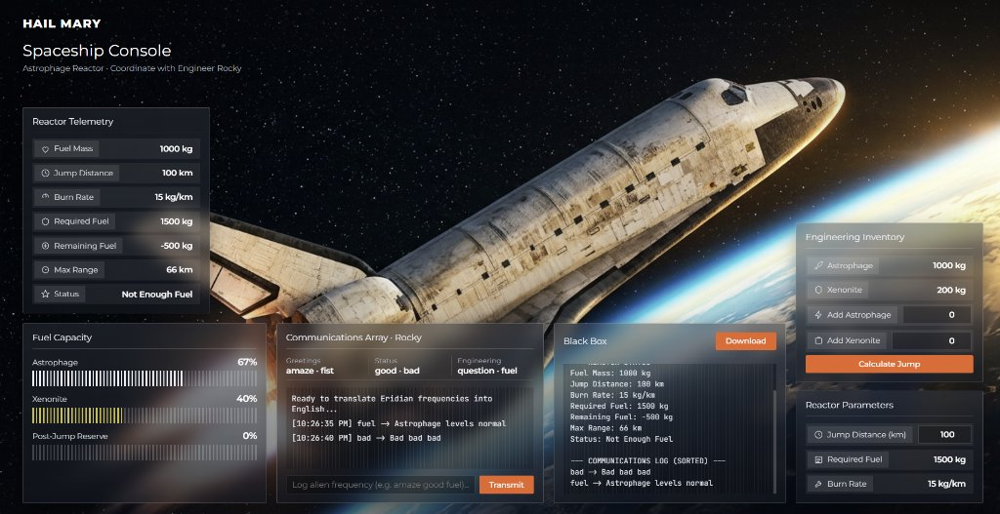

# Hail Mary — Spaceship Console (Deep Space Resource & Translation Matrix)



A multi-language starship flight computer dashboard built to track volatile **Astrophage** fuel levels, manage **Xenonite** inventory, calculate sector jump viability, and translate **Eridian** frequencies into English to coordinate with Engineer Rocky.

---

## Architecture (8 Languages Across 6 Components)

1. **The Ship's Console (`HTML` & `CSS`)**
   - **[index.html](index.html)** & **[style.css](style.css)**: A sleek, dark-mode frosted-glass spaceship console featuring **Engineering Inventory**, **Reactor Parameters**, **Reactor Telemetry**, **Fuel Capacity** meters, **Communications Array**, and the **Black Box** log viewer.

2. **The Safety Protocols (`TypeScript` & `JavaScript`)**
   - **[script.ts](script.ts)** (compiled to **[script.js](script.js)**): Frontend validation functions (`checkFuel` and `checkMessage`) that prevent negative fuel/material inputs or invalid special characters before updating the UI (`"Transmitting..."`) and sending JSON payloads to the Python backend via `fetch()`.

3. **The Ship's Memory (`SQL`)**
   - **[data.sql](data.sql)**: SQLite schema and seed data creating the `Inventory` table (tracking total mass of `Astrophage` and `Xenonite`) and the `Dictionary` table (storing Eridian phrases alongside their English translations).

4. **The Central AI (`Python`)**
   - **[main.py](main.py)**: Flask web server that serves the console, processes `fetch()` requests, executes `sqlite3` queries to update `data.db`, and uses `subprocess.run()` to trigger the compiled C# and Java engines.

5. **The Reactor Logic (`C#`)**
   - **[Program.cs](Program.cs)**: Console application that receives the current fuel mass and jump distance from Python, calculates the required fuel (`15 kg/km × Jump Distance`), burn rate, remaining reserve, and maximum range, formats the telemetry into `pipeline.txt`, and triggers the Java exporter.

6. **The Black Box Exporter (`Java`)**
   - **[report.java](report.java)**: Reads the processed reactor telemetry (`pipeline.txt`) and translated messages (`messages.txt`), sorts the communications log using `Collections.sort()`, and uses `java.util.Formatter` to generate a permanent, downloadable `Captains_Log.txt` file.

---

## Getting Started

### Prerequisites
- **Python 3** with `flask` (`pip install flask`)
- **.NET SDK** (`dotnet`)
- **Java JDK** (`javac` & `java`)
- **TypeScript** (`tsc`, optional if editing `script.ts`)

### Build & Run
```bash
# 1. Compile C# Reactor Logic and Java Black Box Exporter
dotnet build
javac report.java

# 2. Start the Flask Central AI Server
python main.py
```

Open **`http://127.0.0.1:5000`** in your browser.
